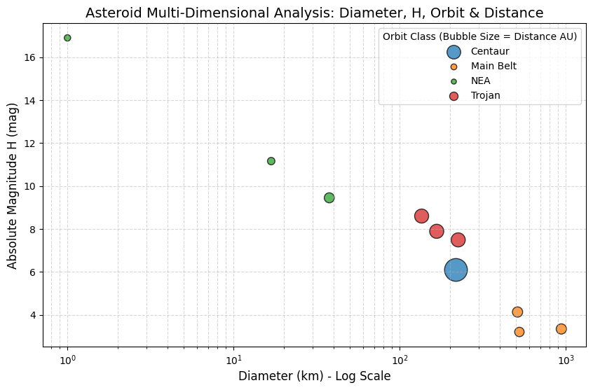

# 🪐 太陽系小行星多維度數據分析（Asteroid Data Analysis）

本專案為自主學習計畫成果，運用 Google Colab 與 Python (`Pandas`、`Matplotlib`) 對太陽系小行星（主帶小行星、近地小行星、特洛伊群與半人馬小行星）進行資料清理、分組統計與多維度視覺化分析。

## 📊 核心分析結果：四維對數泡泡圖

### 圖表維度設計說明
* **X 軸（對數尺度 Log Scale）**：天體直徑（`Diameter, km`），解決太陽系天體尺寸跨越數個數量級的視覺重疊問題。
* **Y 軸**：絕對星等（`Absolute Magnitude H`），數值越小代表天體本身亮度越高。
* **顏色區分（Color）**：軌道類別（`Orbit Class`），比較不同軌道族群的分佈特徵。
* **泡泡面積（Bubble Size）**：與太陽的平均距離（`Distance, AU`）。

---

## 🏗️ 程式模組化架構（Data Pipeline）

本專案採用單一職責原則（Single Responsibility Principle），將分析流程重構為五個獨立模組化函數：

1. **`load_data()`**：載入小行星觀測資料集。
2. **`check_missing(df)`**：執行各欄位缺失值診斷檢查。
3. **`fill_missing(df)`**：針對缺漏數值執行填補清理。
4. **`show_summary(df)`**：依 `orbit_class` 進行多指標分組聚合統計，並校正終端機中西文寬度對齊。
5. **`draw_bubble_chart(df)`**：繪製四維對數泡泡圖並匯出高解析度圖檔。

---

## 🛠️ 開發環境與使用套件

* **開發平台**：Google Colab (Python 3)
* **資料處理**：`pandas`
* **視覺化繪圖**：`matplotlib`
